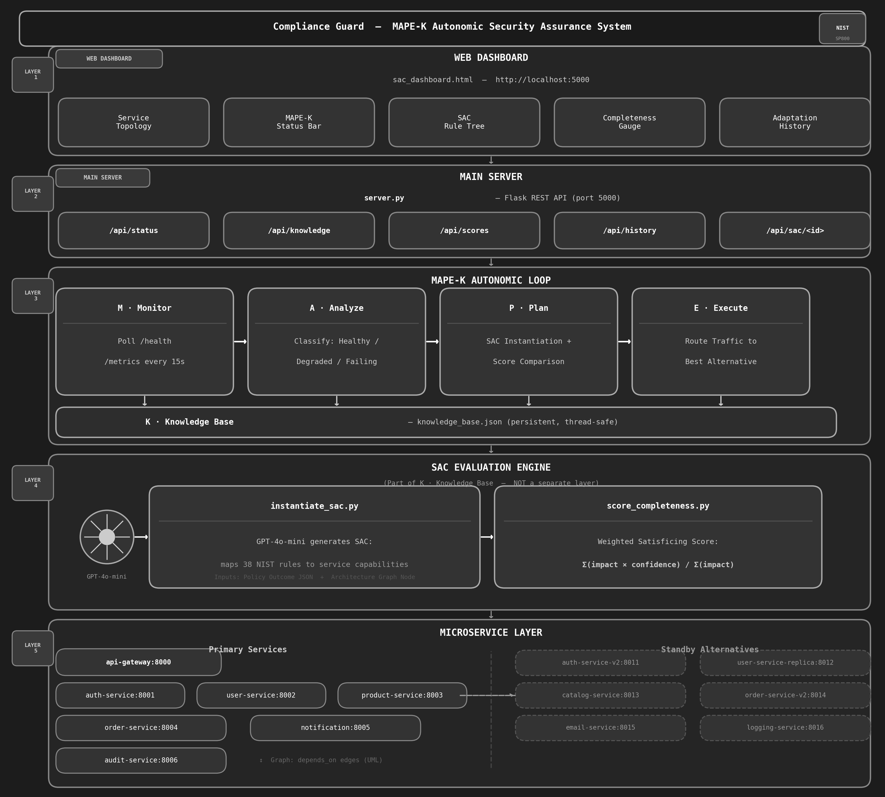

# Compliance Guard: Automated Security Assurance Case (SAC) Instantiation & Self-Adaptive MAPE-K Failover for Cloud Microservices

[](https://www.python.org/)
[](https://csrc.nist.gov/publications/detail/sp/800-53/rev-5/final)
[](#3-7-level-gsn-security-assurance-case-hierarchy)
[](#4-end-to-end-pipeline--reproducible-execution)
[](LICENSE)

**Compliance Guard** is an automated framework for **LLM-assisted regulatory policy extraction**, **Labeled Property Graph (LPG) cloud architecture modeling**, **7-level Goal Structuring Notation (GSN) Security Assurance Case (SAC) instantiation**, **quantitative satisficing completeness scoring**, and **self-adaptive MAPE-K runtime service failover** under **NIST SP 800-53 Revision 5**.



---

## 1. System Architecture Overview

Modern cloud microservice architectures undergo frequent topological and operational changes that can silently invalidate regulatory compliance postures. **Compliance Guard** bridges the gap between unstructured regulatory text and runtime self-adaptation through four tightly integrated layers:

1. **Layer 1 — Automated Compliance Rule Extraction (`extract_schema.py` → `extracted_schema.json` [Object 1]):**  
   Ingests unstructured regulatory policy text (`nist_sp800_53_sample.txt`, covering NIST SP 800-53 Rev. 5 Access Control family `AC-1` through `AC-24`) and extracts **38 atomic compliance rules** into a strongly typed Pydantic schema. Each rule captures Organization-Defined Parameters (`odp_assignments`), Security Control Network interdependencies (`related_controls`), parameter flow provision sets (`provision_set`), operational scope (`actor`, `action`, `data_domain`, `context`), testability signals, and an achievement weight (`impact_factor`).
2. **Layer 2 — Labeled Property Graph (LPG) Architecture Modeling (`graph_builder.py` → `system_architecture_graph.json` [Object 2]):**  
   Constructs a pure-Python **117-node, 156-edge Labeled Property Graph** representing a **13-microservice cloud testbed** (**7 active baseline services** and **6 standby replacement candidates**), their security capabilities, runtime telemetry metrics, and NIST control scope relationships.
3. **Layer 3 — 7-Level GSN Security Assurance Case (SAC) Engine (`sac/`):**  
   Maps all 38 atomic compliance rules against a target microservice's LPG neighborhood to instantiate a complete **7-level Goal Structuring Notation (GSN)** assurance tree (`Context`, `MainGoal`, `Strategy`, `ReqGoal`, `ModuleGoal`, `OpGoal`, `Solution`, and `SupportedBy` edges). Includes a hybrid **LLM + LPG tailoring pipeline** (`sac/extract_context.py`, `sac/extract_req_goals.py`), a quantitative weighted completeness scorer (`sac/score_completeness.py`), and a differential change impact analyzer (`sac/change_impact.py`).
4. **Layer 4 — Self-Adaptive MAPE-K Runtime Engine & Web Dashboard (`mapek/`, `microservices/`, `server.py`):**  
   Continuously monitors live microservice health (**Monitor**), detects SLA violations or service failures (**Analyze**), evaluates standby replacement candidates by instantiating hypothetical SACs and ranking their weighted compliance completeness scores (**Plan**), and executes automated failover by updating API Gateway routing (**Execute**) over a shared runtime repository (**Knowledge**).

---

## 2. Repository Structure

```text
Compliance-Guard/
├── .env.example                            # Template environment variables (OPENAI_API_KEY)
├── .gitignore                              # Git ignore rules
├── LICENSE                                 # MIT License
├── README.md                               # Project documentation & quick-start guide
├── requirements.txt                        # Python package dependencies
│
├── demo_run.py                             # 5-stage end-to-end executable demonstration script
├── extract_schema.py                       # Layer 1: LLM compliance rule extractor (NIST -> Object 1)
├── validate_schema.py                      # Layer 1b: Schema validation & rule coverage verifier
├── audit_schema.py                         # Layer 1c: Automated rule quality & testability auditor
├── graph_builder.py                        # Layer 2: Pure-Python Labeled Property Graph (LPG) engine
├── server.py                               # Layer 4: Flask web server & background MAPE-K controller
├── sac_dashboard.html                      # Interactive GSN Assurance Tree & MAPE-K web dashboard
├── reset_db.py                             # Utility to reset knowledge_base.json to baseline state
│
├── extracted_schema.json                   # Object 1: 38 atomic NIST SP 800-53 Rev. 5 rules
├── system_architecture.json                # Declarative 13-microservice cloud topology specification
├── system_architecture_graph.json          # Object 2: 117-node, 156-edge Labeled Property Graph (LPG)
├── knowledge_base.json                     # Shared MAPE-K runtime state & SAC store
├── nist_sp800_53_sample.txt                # Raw NIST SP 800-53 Rev. 5 Access Control (AC) policy text
├── hipaa_sample.txt                        # Sample HIPAA Security Rule policy text
│
├── sac/                                    # Layer 3: Security Assurance Case (SAC) & GSN Engine
│   ├── __init__.py
│   ├── instantiate_sac.py                  # 7-level GSN assurance tree constructor
│   ├── extract_context.py                  # Hybrid LLM + LPG tailoring parameter (ODP) extractor
│   ├── extract_req_goals.py                # Hybrid LLM + LPG requirement goal & assessment extractor
│   ├── score_completeness.py               # Quantitative weighted satisficing completeness scorer
│   └── change_impact.py                    # Differential SAC change impact analyzer
│
├── mapek/                                  # Layer 4: Self-Adaptive MAPE-K Runtime Engine
│   ├── __init__.py
│   ├── monitor.py                          # Polls live microservice health & latency/error metrics
│   ├── analyzer.py                         # Detects service failures, SLA violations, & degradations
│   ├── planner.py                          # Evaluates standby replacements via SAC completeness scoring
│   ├── executor.py                         # Executes service failover & updates API Gateway routing
│   └── knowledge.py                        # Shared MAPE-K knowledge base interface
│
├── microservices/                          # Simulated 13-Microservice Cloud Testbed (7 Active + 6 Standby)
│   ├── service_base.py                     # Shared HTTP microservice base with telemetry & fault injection
│   ├── start_all.py                        # Multi-process launcher for all 13 microservices
│   ├── api_gateway.py                      # Port 8001: API Gateway & dynamic router
│   ├── auth_service.py                     # Port 8002: Primary Authentication Service (baseline)
│   ├── auth_service_v2.py                  # Port 8009: Enhanced Auth Service v2 (MFA, ABAC, standby)
│   ├── user_service.py                     # Port 8003: Primary User Management Service
│   ├── user_service_replica.py             # Port 8010: Standby User Service Replica
│   ├── product_service.py                  # Port 8004: Primary Product Service
│   ├── catalog_service.py                  # Port 8011: Standby Catalog Service
│   ├── order_service.py                    # Port 8005: Primary Order Processing Service
│   ├── order_service_v2.py                 # Port 8012: Standby Order Service v2
│   ├── notification_service.py             # Port 8006: Primary Notification Service
│   ├── email_service.py                    # Port 8013: Standby Email Service
│   ├── audit_service.py                    # Port 8007: Primary Audit & Compliance Service
│   └── logging_service.py                  # Port 8014: Standby Logging Service
│
├── sac_instances/                          # Pre-Generated Output Audit Artifacts
│   ├── demo_sac_auth-service.json          # Full 7-level GSN SAC tree for auth-service (46.1%)
│   ├── demo_sac_auth-service-v2.json       # Full 7-level GSN SAC tree for auth-service-v2 (50.9%)
│   └── demo_impact_report.json             # Differential SAC change impact report (+4.9% delta)
│
├── figures/                                # System Architecture Diagrams
│   ├── compliance_guard_architecture_v6.png
│   └── compliance_guard_architecture.png
│
└── documentation/                          # Technical Reports & Specifications
    ├── Implementation_Report.md            # Implementation breakdown & 7-level GSN mapping report
    ├── Pipeline_Documentation.md           # Full 3-layer extraction & MAPE-K pipeline specification
    ├── Pipeline_Documentation_v7.pdf       # Compiled PDF technical architecture specification
    └── prompt_engineering_guidelines.md    # Structured LLM prompt engineering guidelines
```

---

## 3. 7-Level GSN Security Assurance Case Hierarchy

Each instantiated Security Assurance Case (`sac/instantiate_sac.py`) constructs a formal 7-level **Goal Structuring Notation (GSN)** hierarchy linking high-level NIST controls to live operational evidence:

| GSN Level | Node Type | Identifier Format | Description |
| :--- | :--- | :--- | :--- |
| **Level 0** | `Context` | `AC-3 [1]`, `AC-2(a) [1]` | Organization-Defined Parameter (ODP) assignments tailored to the target microservice's LPG capabilities |
| **Level 1** | `MainGoal` | `AC-3`, `AC-2` | Top-level security control claim (aggregated per base NIST control ID) |
| **Level 2** | `Strategy` (Top) | `AC-3_S1` | Argumentation strategy decomposing `MainGoal` across functional sub-requirements |
| **Level 3** | `ReqGoal` | `AC-3 Req1` | Sub-requirement goal extracted from the atomic NIST rule obligation |
| **Level 4** | `ModuleGoal` | `AC-3_Req1_M1` | Assessment process module (`Assessment: access_check`) derived from testability signals |
| **Level 5** | `Strategy` (Sub) | `AC-3_Req1_M1_S` | Operational decomposition strategy linking assessment modules to system capabilities |
| **Level 6** | `OpGoal` | `AC-3_Req1_M1_Op1` | Concrete microservice capability claim (e.g., `rbac_enforcement`, `abac_attribute_check`) |
| **Level 7** | `Solution` | `AC-3_Req1_M1_Op1_Sol` | Concrete runtime verification evidence with live service telemetry (`availability`, `error_rate`, `latency_ms`) |

### Quantitative Satisficing Completeness Formulation

For a microservice $S$ evaluated against the set of atomic compliance rules $R$, each rule $r \in R$ has an impact weight $w_r \in [0, 1]$ (`impact_factor`) and a satisficing status score $s_r(S) \in \{1.0\text{ (satisfied)}, 0.5\text{ (partial)}, 0.0\text{ (missing)}\}$:

$$\text{Completeness}(S) = \frac{\sum_{r \in R} w_r \cdot s_r(S)}{\sum_{r \in R} w_r} \times 100\%$$

---

## 4. End-to-End Pipeline & Reproducible Execution

### 4.1 Prerequisites & Installation

1. **Python 3.10+**
2. Install dependencies:
   ```bash
   pip install -r requirements.txt
   ```
3. *(Optional)* Configure OpenAI API key for live LLM extraction (built-in deterministic offline fallbacks are automatically used when `OPENAI_API_KEY` is not set):
   ```bash
   cp .env.example .env
   # Edit .env and set OPENAI_API_KEY=sk-...
   ```

### 4.2 Quick Start: Run the 5-Stage End-to-End Demonstration (`demo_run.py`)

Execute the complete 5-stage pipeline out-of-the-box:

```bash
python demo_run.py
```

#### What `demo_run.py` Executes and Verifies:

| Stage | Pipeline Operation | Key Output / Verification |
| :--- | :--- | :--- |
| **Step 1** | **Load Labeled Property Graph (`Object 2`)** | Loads **117 nodes** and **156 edges** across **13 microservices** (7 active, 6 standby) from `system_architecture_graph.json` |
| **Step 2** | **Capability Comparison (`auth-service` vs. `auth-service-v2`)** | Identifies **10 capabilities** on `auth-service` vs. **18 capabilities** on `auth-service-v2` (**8 newly satisfied** capabilities including MFA, ABAC, privilege monitoring, and rate limiting) |
| **Step 3** | **7-Level GSN SAC Instantiation** | Evaluates all **38 atomic NIST SP 800-53 rules** (`Object 1`), applies hybrid LLM+LPG tailoring for `AC-3`, and attaches runtime telemetry to **62–63 Solution nodes** |
| **Step 4** | **Differential Change Impact Assessment** | Computes completeness increase from **46.1% → 50.9%** (live LLM) or **48.9% → 53.8%** (offline fallback), yielding a **+4.9% net improvement** across 3 rules (`NIST-AC-1-c`, `NIST-AC-5-a`, `NIST-AC-6-5`) with **0 degraded rules** |
| **Step 5** | **Self-Adaptive MAPE-K Failover Decision** | Simulates failure of `auth-service`, ranks standby replacement candidates by SAC completeness score, and triggers automated failover to `auth-service-v2` |

### 4.3 Interactive Web Dashboard & Live Microservice Testbed

To launch the 13 simulated microservices along with the live MAPE-K control loop and interactive GSN web dashboard:

```bash
# 1. Reset the runtime knowledge base to clean baseline state
python reset_db.py

# 2. (Optional) Start all 13 simulated microservices (Ports 8001-8014) in a separate terminal
python microservices/start_all.py

# 3. Start the Compliance Guard server and MAPE-K loop
python server.py
```

Then open **`http://localhost:5000`** in your browser to inspect the interactive **GSN Assurance Tree visualizer**, **service completeness scorecards**, and **real-time MAPE-K adaptation logs**.

---

## 5. License

This project is licensed under the **MIT License** — see the [LICENSE](LICENSE) file for details.
